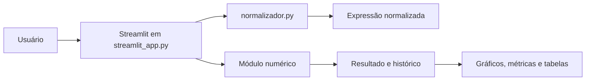

# Métodos Numéricos e Computacionais

Aplicação interativa para estudar, executar e comparar métodos clássicos de cálculo numérico. O projeto combina uma interface visual em Streamlit com implementações independentes dos algoritmos, permitindo acompanhar resultados, históricos de iteração, tabelas intermediárias e representações gráficas.

<p>
  <a href="https://dionatan-metodos-numericos.streamlit.app/" target="_blank" rel="noopener noreferrer">VIZUALIZAR APLICAÇÃO ONLINE</a>
</p>

## 1. Construção do Projeto

### Visão geral

O sistema foi construído com uma separação simples entre interface, tratamento de expressões e algoritmos matemáticos. O arquivo `streamlit_app.py` é o ponto de entrada e coordena a experiência inteira: seleção do módulo, entrada de dados, execução do método, apresentação dos resultados e atualização dos gráficos.



### Linguagem e tecnologias

| Camada              | Tecnologia                   | Uso no projeto                                                   |
| ------------------- | ---------------------------- | ---------------------------------------------------------------- |
| Linguagem           | Python 3.14 ou superior      | Implementação da interface e dos algoritmos                      |
| Interface           | Streamlit                    | Componentes interativos, formulários, abas e estado da aplicação |
| Computação numérica | NumPy                        | Vetores, polinômios, amostras e operações numéricas              |
| Dados               | Pandas                       | Tabelas de iterações, resíduos, matrizes e resultados            |
| Visualização        | Plotly Graph Objects         | Gráficos de convergência, ajustes, interpolação e integração     |
| Álgebra simbólica   | SymPy                        | Derivadas, integração exata e expressões polinomiais             |
| Estilo              | CSS customizado              | Tema escuro, layout, tipografia Nunito e componentes visuais     |
| Ambiente            | `pyproject.toml` e `uv.lock` | Dependências e reprodutibilidade do ambiente                     |

### Organização dos arquivos

| Local                            | Responsabilidade                                          |
| -------------------------------- | --------------------------------------------------------- |
| `streamlit_app.py`               | Ponto de entrada, interface e integração entre os métodos |
| `style.css`                      | Identidade visual e responsividade da aplicação           |
| `normalizador.py`                | Normalização de expressões digitadas pelo usuário         |
| `src/01-zeros-de-funcoes`        | Bisseção, falsa posição, Newton-Raphson e secantes        |
| `src/02-sistemas-lineares`       | Gauss, LU, Jacobi e Gauss-Seidel                          |
| `src/03-ajuste-de-curvas`        | Ajuste polinomial por mínimos quadrados                   |
| `src/04-Interpolacao-polinomial` | Vandermonde, Lagrange e Newton                            |
| `src/05-integração-numerica`     | Trapézios repetida e Simpson 1/3                          |

### Decisões de implementação

- Os diretórios em `src` possuem nomes descritivos, inclusive com hífens e acentos. Por isso, `streamlit_app.py` adiciona seus caminhos ao `sys.path` usando a localização real do arquivo, evitando dependência do diretório de onde o comando foi executado.
- As expressões podem ser digitadas com notação próxima da linguagem natural, como `2x`, `sen(x)`, `ln(x)`, `x^3` e números decimais com vírgula.
- Os métodos detalhados retornam históricos, matrizes intermediárias ou tabelas para que a interface mostre não apenas o resultado final, mas também o caminho da solução.
- O frontend usa uma área de resultado consistente: métricas ficam à esquerda, gráficos na primeira aba e tabelas ou detalhes na segunda aba.

## 2. Métodos e Contratos de Entrada

Esta sessão descreve o que cada método resolve, quais dados recebe e o que devolve. As funções simples retornam o resultado principal; as versões com sufixo `_detalhado` retornam informações adicionais usadas pela interface.

### 2.1 Zeros de funções

Objetivo: encontrar um valor $x$ para o qual $f(x) = 0$.

| Método                                         | Entrada principal                                                                          | Retorno             |
| ---------------------------------------------- | ------------------------------------------------------------------------------------------ | ------------------- |
| `bissecao(expr, a, b, tol, max_iter=100)`      | Expressão, extremos de um intervalo com mudança de sinal, tolerância e limite de iterações | `(raiz, historico)` |
| `falsa_posicao(expr, a, b, tol, max_iter=100)` | Os mesmos dados da bisseção                                                                | `(raiz, historico)` |
| `newton(expr, chute, tol, max_iter=100)`       | Expressão, chute inicial, tolerância e limite de iterações                                 | `(raiz, historico)` |
| `secantes(expr, x0, x1, tol, max_iter=100)`    | Expressão, dois chutes iniciais, tolerância e limite de iterações                          | `(raiz, historico)` |

**Como escolher os dados:** bisseção e falsa posição precisam de um intervalo em que a função mude de sinal. Newton precisa de um chute razoável e pode ser sensível a derivadas próximas de zero. Secantes não exige derivada, mas precisa de dois pontos iniciais adequados.

O `historico` contém valores como iteração, aproximação, erro e, quando aplicável, os limites `a` e `b`. Esse histórico alimenta o gráfico de convergência e a tabela da interface.

### 2.2 Sistemas lineares

Objetivo: resolver $A x = b$, em que `A` é uma matriz quadrada e `b` é o vetor de termos independentes.

| Método                                                | Entrada principal                             | Retorno                           |
| ----------------------------------------------------- | --------------------------------------------- | --------------------------------- |
| `eliminacao_gauss(A, b)`                              | Matriz quadrada `A` e vetor `b`               | Vetor solução `x`                 |
| `eliminacao_gauss_detalhada(A, b)`                    | Matriz quadrada `A` e vetor `b`               | `(solucao, etapas, informacao)`   |
| `fatoracao_lu(A, b)`                                  | Matriz quadrada `A` e vetor `b`               | Vetor solução `x`                 |
| `fatoracao_lu_detalhada(A, b)`                        | Matriz quadrada `A` e vetor `b`               | `(solucao, L, U, y)`              |
| `gauss_jacobi(A, b, x0=None, tol=1e-5, max_iter=100)` | `A`, `b`, chute opcional, tolerância e limite | Vetor solução ou `None`           |
| `gauss_jacobi_detalhado(...)`                         | Os mesmos dados                               | `(solucao, historico, convergiu)` |
| `gauss_seidel(A, b, x0=None, tol=1e-5, max_iter=100)` | `A`, `b`, chute opcional, tolerância e limite | Vetor solução ou `None`           |
| `gauss_seidel_detalhado(...)`                         | Os mesmos dados                               | `(solucao, historico, convergiu)` |

Gauss e LU são métodos diretos. Jacobi e Gauss-Seidel são iterativos e funcionam melhor quando a matriz é diagonalmente dominante ou atende a condições de convergência. O histórico iterativo contém o vetor aproximado e o erro de cada passo.

### 2.3 Ajuste polinomial

Objetivo: encontrar um polinômio que represente uma tendência aproximada para um conjunto de pontos, minimizando os resíduos quadráticos.

| Função                                    | Entrada                                                  | Retorno                                                            |
| ----------------------------------------- | -------------------------------------------------------- | ------------------------------------------------------------------ |
| `ajuste_polinomial(x, y, grau)`           | Listas `x` e `y` com o mesmo tamanho e grau do polinômio | Coeficientes do polinômio                                          |
| `ajuste_polinomial_detalhado(x, y, grau)` | Os mesmos dados                                          | `(coeficientes, matriz_A, vetor_B, R2, SQE, SQT, tabela_residuos)` |

É necessário ter mais pontos do que o grau escolhido. O retorno detalhado permite visualizar as equações normais, o valor de $R^2$, a soma quadrática dos erros e cada resíduo calculado.

### 2.4 Interpolação polinomial

Objetivo: construir um polinômio que passe exatamente pelos pontos fornecidos.

| Método                                         | Entrada                                     | Retorno                                                         |
| ---------------------------------------------- | ------------------------------------------- | --------------------------------------------------------------- |
| `interpolacao_definicao(x_pts, y_pts, x_eval)` | Nós `x`, valores `y` e ponto de avaliação   | Valor interpolado                                               |
| `interpolacao_definicao_detalhada(...)`        | Os mesmos dados                             | Valor, coeficientes e matriz de Vandermonde                     |
| `interpolacao_lagrange(x_pts, y_pts, x_eval)`  | Nós distintos, valores e ponto de avaliação | Valor interpolado                                               |
| `interpolacao_lagrange_detalhada(...)`         | Os mesmos dados                             | Valor, polinômios base e expressão simbólica                    |
| `interpolacao_newton(x_pts, y_pts, x_eval)`    | Nós distintos, valores e ponto de avaliação | Valor interpolado                                               |
| `interpolacao_newton_detalhada(...)`           | Os mesmos dados                             | Valor, tabela de diferenças, coeficientes e expressão simbólica |

Os nós `x_pts` devem ser distintos. Vandermonde resolve um sistema linear, Lagrange combina polinômios base e Newton utiliza diferenças divididas, que também ficam disponíveis na tabela detalhada.

### 2.5 Integração numérica

Objetivo: aproximar a integral de uma função em um intervalo $[a,b]$.

| Método                                     | Entrada                                                    | Retorno                                                |
| ------------------------------------------ | ---------------------------------------------------------- | ------------------------------------------------------ |
| `regra_trapezios_repetida(expr, a, b, n)`  | Expressão, extremos do intervalo e número de subintervalos | Valor aproximado da integral                           |
| `regra_trapezios_detalhada(expr, a, b, n)` | Os mesmos dados                                            | Integral, passo, tabela, soma interna e subintervalos  |
| `regra_simpson_13(expr, a, b, n)`          | Expressão, extremos e `n` par                              | Valor aproximado da integral                           |
| `regra_simpson_detalhada(expr, a, b, n)`   | Os mesmos dados                                            | Integral, passo, tabela, somas e segmentos parabólicos |

O número de subintervalos de Simpson precisa ser par. As versões detalhadas retornam os pontos e pesos usados no cálculo, além da geometria utilizada para preencher a área no gráfico.

### Expressões aceitas

O normalizador reconhece operações e nomes comuns antes da avaliação numérica:

| Categoria               | Exemplos                                                             |
| ----------------------- | -------------------------------------------------------------------- |
| Potência                | `x^2`, `x**3`, `xˆ4`                                                 |
| Multiplicação implícita | `2x`, `3(x+1)`                                                       |
| Funções                 | `sen(x)`, `cos(x)`, `tan(x)`, `exp(x)`, `ln(x)`, `log(x)`, `sqrt(x)` |
| Constantes              | `pi`, `e`                                                            |
| Decimais                | `2.5`, `2,5`                                                         |

## 3. Execução Local

### Pré-requisitos

- Git instalado.
- Python 3.14 ou superior, conforme definido em `pyproject.toml`.
- Acesso à internet para instalar as dependências e carregar a fonte Nunito usada no visual.

### 1. Clonar o repositório

Substitua a URL de exemplo pelo endereço real do repositório:

```bash
git clone https://github.com/Dionatan2019Rodrigues/metodos-numericos.git
cd metodos-numericos
```

### 2. Criar e ativar um ambiente virtual

No Windows PowerShell:

```powershell
python -m venv .venv
.\.venv\Scripts\Activate.ps1
```

No macOS ou Linux:

```bash
python3 -m venv .venv
source .venv/bin/activate
```

### 3. Instalar as dependências

Com o ambiente virtual ativo, instale as bibliotecas usadas pela aplicação:

```bash
python -m pip install --upgrade pip
python -m pip install streamlit numpy pandas plotly sympy
```

Como alternativa, utilizando o gerenciador `uv`:

```bash
uv sync
```

### 4. Iniciar a aplicação

O ponto de entrada do projeto é `streamlit_app.py`:

```bash
streamlit run streamlit_app.py
```

Depois da inicialização, abra o endereço exibido no terminal, normalmente:

```text
http://localhost:8501
```
